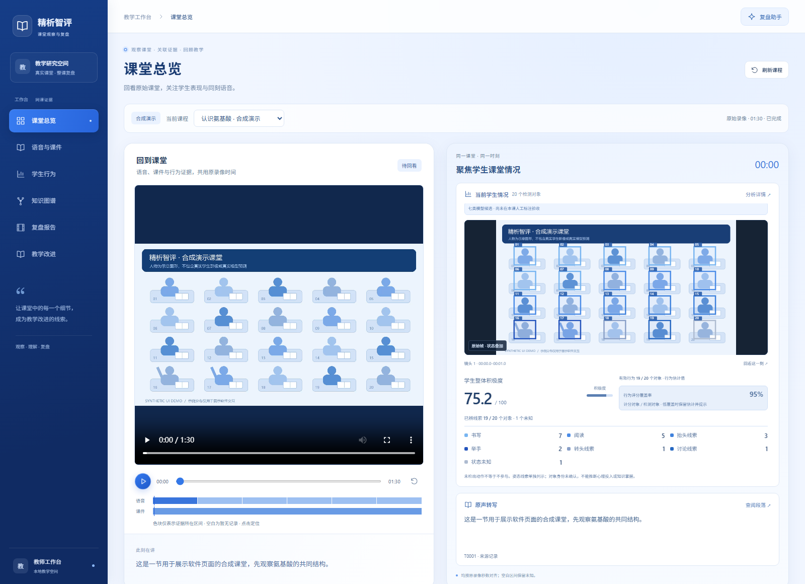
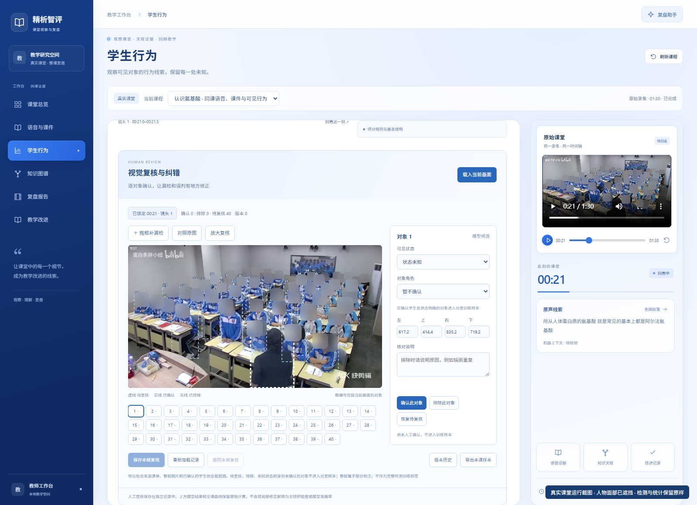
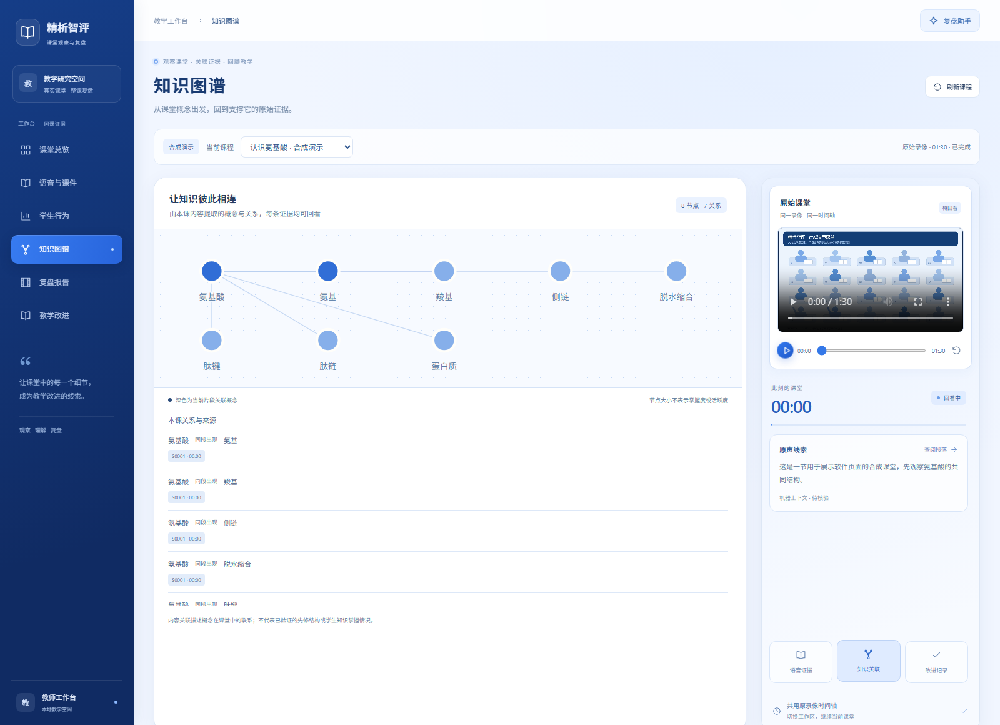

# 精析智评

精析智评是一款面向教师的本地课堂分析与教学复盘辅助系统。系统以课堂录像为基础，将语音转写、课件内容、学生可见行为和知识概念组织到统一时间轴，支持课堂回看、结果复核、证据问答、报告导出和教学改进。

教师可以从一个课堂片段出发，查看同一时刻的教学内容与学生表现，核对机器识别结果，并将复盘发现转化为改进计划、课后练习和反馈记录。

## 核心功能

| 功能模块 | 主要能力 |
| --- | --- |
| 课堂概览 | 同步回放课堂录像、学生状态、整体积极度和语音转写 |
| 语音与课件 | 对照原始转写与机器校对，导入 PDF、PPTX 和 PPT，定位对应课堂片段 |
| 学生行为分析 | 展示人物检测框、可见行为分布、变化趋势及评分覆盖情况 |
| 视觉复核 | 支持逐帧补框、标签修订、误检排除、版本恢复和分类样本导出 |
| 知识图谱 | 展示课堂概念、同段关联及原文出处，支持从概念回到来源片段 |
| 复盘报告 | 导出 JSON 和 Markdown，保留观测记录、派生评分和证据引用 |
| 教学改进 | 管理教学目标、教师核对稿、改进计划、实施结果、练习与实际作答 |

人工复核与原始识别记录分别保存，支持版本管理和冲突检测。课件处理任务持久化到 SQLite，支持状态查询、中断状态保留和失败重试。问答结果经过引用校验，证据不足或模型不可用时显示对应状态。

## 页面预览

以下为《认识氨基酸》课堂的实际运行页面，人物面部已匿名化处理。检测框、评分、识别文本和未知状态均来自现有课堂记录。

### 课堂概览

在统一时间轴上查看课堂录像、学生状态、整体积极度和同刻转写。



### 学生行为与视觉复核

对照原始帧检查人物框与行为标签，补充漏检对象、排除误检并保存复核版本。



### 知识图谱

查看课堂概念及其关联，点击节点或引用定位原始证据。



演示片段来自 TS-Interact 训练组，截图用于展示软件功能，不作为独立准确率评测。数据来源与展示范围见 [页面截图说明](docs/screenshots/README.md)。

## 系统架构

| 层次 | 技术与职责 |
| --- | --- |
| Web 工作台 | Vue 3、TypeScript、Vite 和 Pinia，提供课堂回放与复核界面 |
| 服务接口 | Python 3.11、FastAPI 和 Uvicorn，提供 `/api/review` 接口及 OpenAPI 文档 |
| 数据存储 | SQLite 保存教师记录、处理任务、检索索引和人工复核；JSON 保存课堂证据 |
| 媒体处理 | FFmpeg、OpenCV 和 Tesseract，支持音视频处理、画面分析及文字提取 |
| 证据问答 | 课堂文本与时间检索、引用校验，以及独立的 llama.cpp 兼容模型服务 |
| 桌面应用 | Tauri 2 与 Python sidecar，封装本地工作台与后端服务 |

浏览已处理课堂、编辑记录和回看证据无需加载语言模型。视频处理、视觉推理和语言模型通过独立脚本或进程运行，媒体接口支持 Range 和 HEAD 请求。

面向约 8 GB 显存的个人电脑，模型按任务串行加载。实际资源占用取决于模型、上下文长度和运行配置。

## 模型配置

| 任务 | 模型或方案 | 接入方式 |
| --- | --- | --- |
| 语音转写 | faster-whisper Small，CPU int8 | `prepare_media.py` 默认处理方案 |
| 中文语音实验 | Qwen3-ASR-1.7B | 独立实验配置，见 [Qwen 升级说明](backend/docs/QWEN_UPGRADE.md) |
| 辅助语音识别 | FunASR Seaco Paraformer、FSMN-VAD 和 CT-Punc | 可选 SSH 参考通道，需配置远程主机 |
| 人物与姿态检测 | YOLO26n、YOLO26n-pose | 整图与重叠切片融合，人物定位与行为分类分别处理 |
| 可见行为分类 | MobileNetV3 Small | 七类裁剪分类实验，权重约 3.15 MB，保留低置信和冲突状态 |
| 概念提取与问答 | Qwen3-4B GGUF、llama.cpp | 独立本地模型服务，生成结果接受引用检查 |
| 转写校对 | 来源规则、ChineseErrorCorrector4-4B 和 Qwen3.5-4B 对照 | 保留原始转写，机器修订供教师核验 |

模型权重与运行时需单独安装。清单中的 Qwen3-ASR-0.6B、PP-OCRv6 ONNX 和 BGE-small 属于推荐安装项或待适配项。默认问答采用课堂文本检索，向量数据库与 GraphRAG 尚未接入。

## 快速开始

### 环境要求

- Python 3.11 和 [uv](https://docs.astral.sh/uv/)
- Node.js 22 或 24
- 新录像处理另需 FFmpeg、Tesseract 中文与英文语言包，以及相应模型

### 安装与启动

在仓库根目录执行以下命令，安装应用依赖并构建前端：

```powershell
git clone https://github.com/hash-distill/Class-Knowledge-Graph.git
cd Class-Knowledge-Graph
uv venv backend/.venv-media --python 3.11
uv pip install --python backend/.venv-media/Scripts/python.exe -r backend/requirements-app.txt
cd frontend
npm ci
npm run build
cd ..
python scripts/workspace_setup.py
python scripts/run_workbench.py --port 8000 --open-browser
```

启动后访问 [本地工作台](http://127.0.0.1:8000/)。[API 文档](http://127.0.0.1:8000/docs) 位于 `/docs`，健康检查地址为 `/api/review/health`。服务默认监听 `127.0.0.1`。

首次启动会创建空的课程登记和本地数据目录，已有登记不会被覆盖。课堂素材、完整转写、学生原始图像、模型权重和个人工作区需自行准备，源码仅包含经过匿名化处理的页面截图。

Linux/macOS 安装依赖时使用 `backend/.venv-media/bin/python`。启动器支持 Windows 和 Linux/macOS 的虚拟环境布局。桌面安装包与 PowerShell 媒体入口的支持范围见 [桌面与运行时](backend/docs/DESKTOP.md)。

运行 `python scripts/run_workbench.py --check` 可检查路径、工具和前端构建状态。通过 `--python`、`--registry` 和 `--data-dir` 指定解释器、课程登记和本地状态目录。

## 接入课堂数据

已处理课程通过本地文件 `backend/configs/lessons.json` 登记：

```json
{
  "my-lesson": {
    "directory": "../artifacts/my-lesson",
    "source_video": "../local-media/my-lesson.mp4"
  }
}
```

相对路径以登记文件所在目录为基准，也支持绝对路径。`directory` 应包含完整且来源一致的 `bundle.json` 及对应证据文件。登记录像路径后，仍需运行媒体处理与分析流程。

新录像处理需配置实际的课件区域、媒体依赖和模型，操作步骤见 [后端与课堂处理](backend/README.md) 及 [视觉模块](vision/README.md)。PDF、PPTX 和 PPT 导入用于向已登记课堂补充课件。

问答服务配置见 [本地模型说明](backend/docs/LOCAL_LLM.md)。配置外部 `REVIEW_LLM_BASE_URL` 后，检索证据会发送至该服务；可选辅助语音识别会将课堂 WAV 发送到指定 SSH 主机。原始媒体与课程登记文件应保存在本地。

## 评分方法

整体积极度采用 `overall_behavior_engagement_v1`，以检测对象的可见行为为输入。动作权重为：书写 85、阅读 80、抬头 85、转头 30、举手 95、站立 90 和讨论 75。

有效行为分归一化后，按以下公式计算，并在连续同镜头观测间进行时间平滑：

```text
整体积极度 = 100 × 均值 × exp(-0.6 × 总体标准差)
```

至少一个可信行为对象可产生估计分。不足 3 个对象或评分覆盖率低于 60% 时，界面标记“低支持估计”。无人物、无有效行为和未识别状态保留未知。人工复核结果独立保存，暂不自动重算全课模型曲线。详细定义见 [评分说明](backend/docs/CLASS_ENGAGEMENT_20261029.md)。

该分数是未经人工校准的可见行为规则估计，不用于判断个人成绩、心理投入或知识掌握。检测框数量不等于班级人数。分类器固定裁剪测试存在相邻画面重叠，相关指标不能作为独立课堂端到端准确率，详见 [视觉分析说明](backend/docs/VISION_IMPROVEMENT_20261029.md)。

## 开发与验证

开发时分别启动 API 与前端开发服务器：

```powershell
# 终端一：启动 API
python scripts/run_workbench.py --api-only --port 8000

# 终端二：启动前端
cd frontend
npm run dev -- --host 127.0.0.1 --port 5175
```

Vite 将 `/api/review` 请求代理至后端。`npm run preview` 用于检查静态构建，完整应用使用源码启动器运行。若 API 在前端首次构建前已启动，构建完成后需在原终端停止并重新启动服务。

执行回归测试、生产构建与源码审计：

```powershell
& backend/.venv-media/Scripts/python.exe -m pytest backend/tests -q
cd frontend
npm test
npm run build
cd ..
python scripts/prepare_release.py --check
```

GitHub Actions 自动执行后端测试、前端测试、生产构建和源码审计。模型准确率与真实课堂效果需另行评测。

使用 `python scripts/prepare_release.py --output release/github-ready` 导出源码。导出内容包括源码目录、ZIP 和逐文件 SHA-256 清单，排除本地登记、数据库、课堂产物、权重、环境及构建目录。发布流程见 [源码发布说明](docs/PUBLISHING.md)。

## 项目结构

```text
backend/     FastAPI 服务、媒体处理、课堂证据与测试
frontend/    Vue 工作台
desktop/     Tauri 桌面应用与打包脚本
vision/      人物定位、姿态分析与行为分类
scripts/     工作区初始化、启动与源码导出
docs/        项目说明与页面截图
```

## 开发文档

- [人工视觉复核与训练样本导出](backend/docs/VISUAL_REVIEW_20261029.md)
- [本地任务与数据架构](backend/docs/LOCAL_ARCHITECTURE.md)
- [独立课件导入与对齐](backend/docs/COURSEWARE.md)
- [前端开发](frontend/README.md)
- [贡献指南](CONTRIBUTING.md)

## 许可与数据使用

项目尚未声明覆盖全部代码的统一开源许可证，许可范围见 [NOTICE](NOTICE)。第三方代码、模型、训练数据与课堂素材分别遵守其原有许可。公开源码不自动授予课堂素材和模型权重的再分发权。
